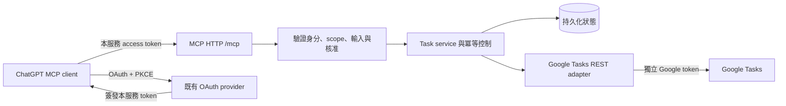
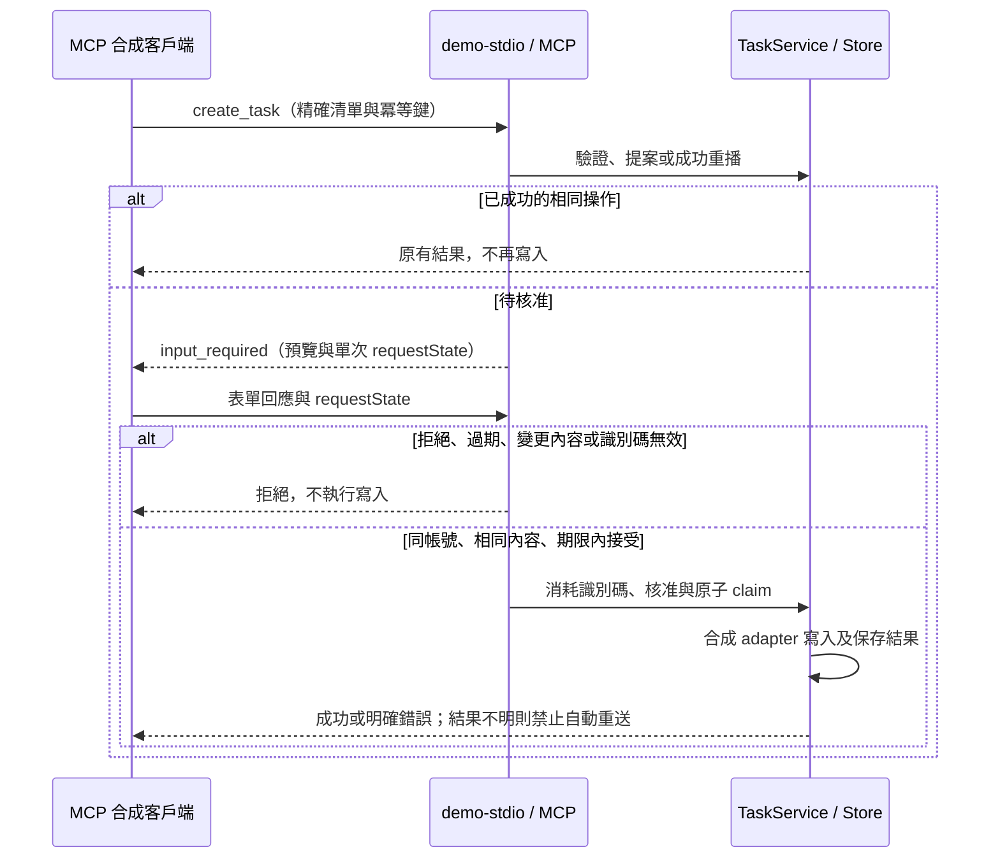

# 建議架構與工具契約

狀態：已核准本地迭代。七工具、REST／OAuth client、SQLite cursor／冪等／加密 vault、合成資料 loopback HTTP 已實作；以下遠端架構仍屬目標。MCP OAuth verifier／正式 provider、HTTPS 與遠端核准尚未實作。官方依據見 [API_CONSTRAINTS](API_CONSTRAINTS.md)。

目前另提供單一 OS 使用者的 Google readonly stdio 測試入口；不等同 ChatGPT 遠端服務。每次重連換 connection ID，舊 stdio client 遇到換綁會拒絕並要求重啟。加密金鑰與資料庫同機，正式部署仍需獨立 secret store。

## Shared private local runtime (D038)

The owner-approved shared path is Codex Mac → loopback HTTP and ChatGPT Web → Secure MCP Tunnel → the same loopback HTTP service in OrbStack. The service owns one Google connection, registers read-only tools only, and checks a separate local static key. The existing macOS Tunnel binary is supervised by the quick-start launcher, not placed in a Linux container. One service/database owner is allowed; do not run old stdio or reconnect Google concurrently. Public remote per-user authentication remains unimplemented.

## 私人唯讀試用分支（D028）

依 [串接計畫](CHATGPT_CONNECTION.md)，先準備 Secure MCP Tunnel → 本機 stdio → OrbStack 的本人私人測試。Google stdio 強制 readOnly 註冊，只暴露四個讀取工具；demo HTTP 七工具行為維持。此路徑沿用單一 OS 擁有人 context，不提供遠端逐人身分驗證，外部啟用須確認僅本人存取，不能供多人共用。正式 OAuth／核准架構仍是以下目標，未被豁免。

## 目標系統邊界（遠端驗證尚未實作）

目前為單一 Node.js／TypeScript 服務，套件以 [package.json](../package.json) 為準，Node 以 [.nvmrc](../.nvmrc) 為準。已有本機 loopback HTTP 與 stdio；正式遠端 Streamable HTTP 為目標。本地 Inspector 僅供開發。沒有 Calendar adapter、LLM API 呼叫或獨立任務 UI。OAuth 必要的回呼不屬於任務管理前端。

建議使用既有 OAuth provider，不自行發明授權伺服器。provider 選擇、正式網域與 HTTPS 主機尚未定案；本地先以 verifier／token-store interfaces 與測試 issuer 實作，不假冒完成正式登入。

目前元件：[domain](../src/domain/SPEC.md)、[storage](../src/storage/SPEC.md)、[google](../src/google/SPEC.md)、[service](../src/service/SPEC.md)、[demo](../src/demo/SPEC.md)、[mcp](../src/mcp/SPEC.md)、[local](../src/local/SPEC.md)。[入口與元件樹](../src/SPEC.md) 保留原有 CLI／HTTP 啟動路徑。只有 service 可協調工具寫入；handler 不可繞過核准與冪等流程。遠端 auth 尚未實作。

## 目標：正式遠端身分與 Google 授權（尚未實作）

1. 驗證 MCP token 的 signature、issuer、audience/resource、exp／nbf、必要 scope；任何缺項拒絕。所有工具含 securitySchemes，HTTP challenge 與工具層 `_meta["mcp/www_authenticate"]` 依官方契約回傳，不回傳 credential。
2. 用 `(issuer, subject)` 解析內部 principal。連結 Google 的流程綁定該 principal、單次 state、redirect allowlist 與期限，防止登入 CSRF／帳號被換綁。
3. v0.1 建議一個 principal 只對應一個啟用 Google connection。重新連結不得沿用前個 connection 的快取、cursor 或 operation key。多帳號選擇介面留待後續。
4. 透過獨立 Google OAuth code flow 取得 Tasks scope；不要求 Calendar、Drive 或 Gmail。Google connection 的穩定內部 ID 為隔離鍵；如需要 OIDC sub 以偵測重連帳號差異，必須另記錄 openid scope 的必要性再定案，不默加 email/profile。
5. Google refresh token 加密保存，金鑰由部署 secret store 提供；依 provider 能力可使用其 vault。不得記錄 bearer token／授權碼。refresh 採每 connection single-flight，缺少新 refresh token 時保留舊值；invalid_grant 要求重新連結。
6. session ID 不是身分；每次 request 重新驗證權限。cursor、cache、冪等紀錄與核准皆綁定 principal + Google connection。禁止 process-global「目前使用者」Google client。
7. 對 discovery／client metadata 抓取做 HTTPS、host／redirect 及內網位址限制，防止 SSRF；HTTP endpoint 驗證 Origin／Host，限制 body、並發與速率。工具輸入只能指定 ID，不能指定任意 API URL。

## 契約來源（Code-first）

工具輸入與推導型別只在 [domain schemas](../src/domain/index.ts) 維護；MCP 註冊、annotations 與錯誤封裝由 [MCP 實作](../src/mcp/index.ts) 定義；結果物件由 [service](../src/service/index.ts) 與相關測試呈現目前行為。此處不再手寫另一份參數／回傳表。例如舊草案使用 matches，但現有 service 搜尋實際使用 items；本輪修正文件定位，不變更 API。

資料結構只以 [Store 初始化 DDL](../src/storage/index.ts) 為準；目前未設獨立 migrations，不以手寫 ER table 取代 DDL。輸入、儲存及結果若與 [PRD](PRD.md) 已確認需求衝突，應新增差異與待決問題，不自動以程式覆寫意圖。

日期的業務語意、範圍及驗收見 [PRD](PRD.md)；外部 API 證據與限制見 [API_CONSTRAINTS](API_CONSTRAINTS.md)。數值上限、預設值、欄位選項、cursor 綁定與搜尋預算均由對應 schema／service／Store 定義目前行為，不在架構文件手抄。

## 允許的來源相依

[components.json](../components.json) 的 allowedDependencies 是跨元件來源相依政策；[Router](INDEX.md) 的圖為其自動產生投影，不是實際 import 清單。現有 service 對 GoogleHttpError 的相依保留，不為文件整理抽象化或重構業務模組。

政策涵蓋 TypeScript 靜態 import／export、type import 與直接的字面量 import()／require()；computed source imports 及 node:module／module runtime loader 在 src 拒絕。這是原始碼結構門檻，不能分析任意 eval、執行期呼叫或惡意程式碼；不構成安全隔離。新增必要的 runtime loader 須先審查政策與替代方案，不以別名逃避檢查。

## 人類核准：開放寫入前必解

OAuth 同意只是授權 scope，不能代表每筆任務的操作同意。`confirmed=true`、模型傳入的 token、單純「先 preview 再 commit」都不能自行證明核准。工具描述及 annotations 只能輔助客戶端。

建議在 domain service 定義 `ApprovalVerifier`，核准紀錄綁定 principal、connection、操作、清單／任務 ID、canonical payload hash、有效期與單次 nonce。重放完成的 operation 可回原結果，但不能再次產生副作用。payload 或對象變更必須重新核准。拿不到可信核准時回 `APPROVAL_REQUIRED`，上游寫入次數為 0。

待驗證路徑：受支援 client 的 MCP elicitation 回應是否能形成獨立且可靠的人類同意通道，且可符合逐筆核准；或最小、經登入保護的伺服器核准頁（若採用，須先核准這項小幅範圍調整）。尚未宣稱任一路徑在 ChatGPT 已可用。此項在第 2 階段前定案；機制未完成時只允許模擬寫入，真實寫入預設關閉。

## 建立冪等與結果不明（原設計約束與建議）

建議單一 instance + 持久磁碟 SQLite；資料庫存 encrypted tokens／connection 引用、核准紀錄、operations。不引入 Redis 或分散式服務。正式部署若不提供持久磁碟，必須改選等價交易型儲存，不能退回記憶體。

唯一鍵：`(principalId, connectionId, tool, idempotencyKey)`；值含 canonical payload hash、state、精簡上游結果、timestamps。並發請求靠交易與 unique constraint 原子競爭，不只做「先查再寫」。token／任務備註不放一般日誌；結果快取視為使用者資料，須保護與訂定保存期限。

原設計狀態概念：`reserved → in_flight → succeeded | failed_definitive | uncertain`。這不是目前資料庫 enum；Store 實作以 `pending` 表示待核准／保留狀態，精確狀態及轉移以 [Store](../src/storage/index.ts) 與 [service](../src/service/index.ts) 為準。以下保留安全設計目的與未決建議，不作第二份機器契約。

- 同 key 同 payload 已成功：回原 Google 結果，不重送。
- 同 key 不同 payload：`IDEMPOTENCY_CONFLICT`。
- in_flight：`OPERATION_IN_PROGRESS`；重啟時留下的 in_flight 一律轉 uncertain，不接管重送。
- 寫前即落盤；DB 不可用時拒絕寫入。任何可能送達 Google 的 timeout／斷線／5xx，或 Google 已成功但本地寫結果失敗，均保守標 uncertain。
- uncertain：`WRITE_OUTCOME_UNKNOWN`、retryable=false、operation reference；禁止原 key 重送。新 key 也不應被建議作為繞路；先讓使用者核對專用清單。不能只憑相同標題／時間視為成功。沒有可靠對應依據時保留未知。
- 明確拒絕（例如驗證 4xx）可記 failed_definitive；不能把所有非 2xx 都認作未寫入。
- 建議操作紀錄至少保留 30 日並公布 key 有效範圍；未解決 uncertain 不自動過期。清除結果內容後仍保留防重 tombstone；最終保存／刪除政策待決，不能先保證永久去重。

讀取可採有界退避（含 jitter／Retry-After）最多 3 次，總預算不延長。建立一旦可能送出就不自動重試。更新／完成逾時也先回報未知並讀回核對，只能在不覆蓋外部變更的條件下恢復，不能盲目重放舊 payload。

更新前讀取並比對核准 snapshot；若已有變更，重新核准。If-Match 支援尚未實測，不能聲稱消除 read/patch 間競態；未具原子條件更新能力時應明確揭露限制，真實寫入開放前完成決策。

## 日期與錯誤

taskDate 在 domain 層是日期字串；adapter 編碼同日期 UTC 零點；結果拆日期，不作本地 instant 轉換。相對日期若需由伺服器解析，必須使用明確 user zone 與注入 clock；v0.1 由 ChatGPT 釐清成絕對日期，server 不接受「明天」。

執行環境啟動時檢查 America/Vancouver 在 2026-11-02 的 offset=-07:00，以及 Asia/Taipei=+08:00。過舊 tzdb 時禁止依此環境作本地日期推導，回明確錯誤或先升級 runtime；仍可處理已確認的純日期。不可用硬編碼 UTC−7 覆蓋歷史。

業務錯誤為 `isError=true`，資料包含 code、簡短 message、retryable、requestId，必要時 operation reference／partial cursor；OAuth challenge 使用專屬 metadata。建議 codes：VALIDATION_ERROR、AUTH_REQUIRED、GOOGLE_REAUTH_REQUIRED、ACCESS_DENIED、NOT_FOUND、APPROVAL_REQUIRED、STALE_TASK、IDEMPOTENCY_CONFLICT、OPERATION_IN_PROGRESS、WRITE_OUTCOME_UNKNOWN、RATE_LIMITED、UPSTREAM_UNAVAILABLE、TIMEZONE_DATA_OUTDATED。未知錯誤不得洩漏 HTTP Authorization、stack 或原始 token response。

## 2026-10-28 P3 本機實作狀態（D030）

合成資料新增 opt-in stdio 表單核准原型：MCP request channel → 明確勾選 → 綁定 persisted payload/ref/digest/context → 重讀快照 → 原子 claim → 版本條件 patch。核准預覽含 before 與 requestedAfter；requestedAfter 是預期內容，不是 Google 已確認結果。60秒取消／逾時、缺少客戶端能力、安全拒絕都不寫入。

這不是正式遠端 ApprovalVerifier：SDK 客戶端本身可以程式化送 accept，尚未證明 ChatGPT 的人類介面與使用者身分。Google stdio 的四工具唯讀限制及 REAL_WRITES_DISABLED 保留；遠端 auth 仍未實作。現有 stateless HTTP handler 無法保留 legacy elicitation 能力，測試確認安全拒絕；不可將此原型接到真實資料或宣稱跨協定可用。

更新／完成 adapter 改要求具體 etag；demo 用原子 SQL version predicate，Google 用 If-Match，412 不重送。後者必須再於已授權專用清單驗證真實 Google 端點，才能解除相應 gate。

## 合成核准路徑與拒絕界線

目前工程流程見 [ENGINEERING_WORKFLOW](ENGINEERING_WORKFLOW.md)，實作依據：[MCP 契約](../src/mcp/SPEC.md)、[service 契約](../src/service/SPEC.md)。此圖只描述合成 modern 入口；真實 MCP 寫入仍關閉。

圖中的接受為協定行為，不能證明實際真人操作。stdio smoke 使用模擬回應；ChatGPT 表單可信性及真實 Google 驗收仍須獨立完成。修改此路徑時同步圖、相關 SPEC 與正反向測試。

## Stable storage driver integration (2026-11-04)

The Store uses the pinned stable `better-sqlite3` driver through its synchronous file API; DDL and durability pragmas remain in Store as the sole source. Native prebuilds replace the Node RC API without a schema migration. The previous Node driver is retained only for disposable compatibility rehearsals. Production data has not been opened or migrated by this change. See D034 and its successor in [decisions](DECISIONS.md) for adoption and validation status.
