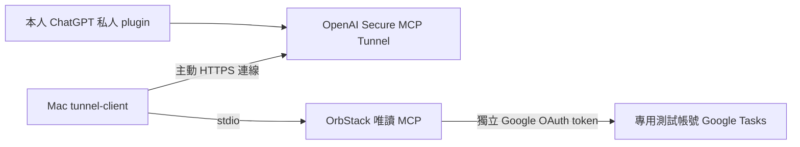

# 私人 ChatGPT 串接計畫與操作紀錄

上層：[文件元件](SPEC.md)。產品放行：[RELEASE_PLAN](RELEASE_PLAN.md)；決策：[D028](DECISIONS.md)；實作：[MCP](../src/mcp/SPEC.md)、[應用入口](../src/SPEC.md)、[容器](../containers/SPEC.md)、[驗證腳本](../scripts/SPEC.md)。

日期：2026-10-27。使用者要求「規劃紀錄執行」；本機與私人 Tunnel 接線已完成，ChatGPT 已實際呼叫一次 Google 唯讀清單工具成功；任務內容查詢及完整產品驗收仍未完成。這是私人唯讀試用的分支，不取代完整 G2–G5，也不解除正式 MCP 寫入 gate。

## 接線與信任邊界



本機 `google-stdio.sh` 不開 HTTP listener。原有 localhost:3000／3001 是合成資料 demo，不作為此路徑上游。Google 憑證只留在既有 .data；Tunnel runtime key 在 Mac 安全輸入／環境引用，不進 container、Git、對話、命令參數或文件。

本路徑是**單一 OS 擁有人、單一 Google 測試連線、僅本人可存取的私人測試**。Tunnel 的 organization／workspace 存取控制不是本服務逐人身分驗證；目前 service context 仍是 local-os-owner。不能分享給同工作區其他成員、不能作多人服務、不能聲稱完成 OAuth verifier。啟用前必須確認實際 Tunnel 與 plugin 存取範圍僅本人；若無法證實此限制，保持未啟用並改走 G2 的正式身分驗證。

四個讀取工具：list_task_lists、list_tasks、search_tasks、get_task。即使 Google 已給 tasks 讀寫 scope，這個 MCP 入口也不註冊新增、更新或完成工具；service 原本 REAL_WRITES_DISABLED 仍保留。讀取權限仍涵蓋連結帳號所有 Tasks 清單，不是伺服器端清單 allowlist；只連接使用者已授權的專用測試帳號，ChatGPT 首輪只做工具列舉，資料案例另指定專用測試清單的精確 ID。此前 CRUD 專用清單已清理，不假設仍存在。

## 階段與驗收

| 階段 | 執行內容 | 完成證據／目前狀態 |
|---|---|---|
| A 本機準備 | 四工具註冊、拒絕寫入、wrapper、規格與決策同步 | 已實作；最終命令結果見 TEST_PLAN |
| B OrbStack 接線 | 完整 check、build，SDK 經實際 container stdio initialize／tools/list | 本輪執行；不呼叫 Google API，不算 ChatGPT E2E |
| C 外部設定 | 確認 Platform 組織與 ChatGPT 空間、僅本人可用、Tunnel／最小 runtime key，安裝官方 client | 已安裝固定 v0.0.18；使用者安全輸入受限 runtime key 並啟動；已儲存 UI 列出的 ChatGPT workspace 關聯，私人外掛已安裝 |
| D 私人唯讀驗收 | doctor／ready／polling、ChatGPT plugin discovery，先驗證四工具 | healthz／readyz HTTP 200；ChatGPT 列出四個唯讀工具，實際 list_task_lists(pageSize=1) 成功；未另行獨立驗證 polling 指標 |
| E 專用資料驗收 | 指定測試清單 ID、讀取／搜尋／換綁拒絕，去識別化紀錄 | 已完成帳號層級清單連線探測；清單內任務查詢／搜尋／換綁拒絕尚未驗收，需專用清單精確 ID |
| F 寫入及正式服務 | 可信逐筆核准、條件更新／競態政策、身分隔離、穩定儲存、備份恢復與 G2–G5 | 未完成，維持停寫；不以 REST CRUD 成功替代 |

## 本機命令

### Restart an existing private connection (2026-10-30)

From the repository root, run one command in an interactive terminal:

```sh
/bin/zsh scripts/start-private-tunnel.zsh synthetic
```

Paste the existing Tunnel runtime key at the hidden prompt and press Enter. Keep the terminal open. Use `readonly` instead of `synthetic` for the existing Google read-only connection, in a separate terminal. Never paste the key into a ChatGPT message. The launcher does not create a credential or grant permissions. For readonly only, the owner may instead save the key in the repository `.env` as described below. An empty prompt aborts. Stop with Ctrl-C. Mac sleep, OrbStack shutdown, key expiry or closing the terminal interrupts availability.


#### Optional local readonly key file (2026-11-04)

The owner approved plaintext local environment-file storage. A secret-free `.env` placeholder has been prepared with owner-only permissions; edit it locally and set `GOOGLE_TASKS_TUNNEL_API_KEY` to the existing runtime key. Use one unquoted value without spaces; do not paste the key into chat. If creating it on another machine, copy `.env.example` to `.env` and run `chmod 600 .env` before editing. Never overwrite an existing populated file with the example.

The readonly launcher reads this fixed file without executing shell code, rejects symlinks, other owners, group/other permissions, duplicate/unknown assignments and invalid values, and ignores inherited runtime keys. Empty/missing values use the hidden prompt. Synthetic credentials remain separate and interactive. `.env` is Git-ignored and excluded from Docker build context; only `.env.example` may be committed. File permissions do not encrypt the key. Keep the existing restricted Tunnels Read + Use scope; renewal remains owner-managed.

Prerequisites: the existing ignored local profile, pinned client v0.0.18, running OrbStack and the corresponding locally built image (`p3-demo` for synthetic, `local` for read-only). A missing setup fails before asking for a key. Invalid or expired keys require renewal through the owner's Platform account with the existing Read/Use permissions; no broader access is needed for a restart. This launcher cannot establish that ChatGPT's form is a trusted human approval channel; that still requires end-to-end evidence.

在專案根目錄執行。build 會執行 check；image tag 是本機建置產物，不是已發布版本。wrapper 使用 --pull never，不會下載未知同名 image。

```sh
docker --context orbstack build -f containers/Dockerfile -t google-tasks-mcp:local .
node scripts/check-google-stdio.mjs
```

協定檢查只列出 protocol／toolCount／readonly 狀態，不呼叫任務工具，也不輸出 credentials、資料 ID 或任務內容。正式 client 上游命令為：

```sh
/bin/sh /path/to/google-tasks-mcp/containers/google-stdio.sh
```

不要用瀏覽器開啟 stdio，也不要把 localhost demo 當成 Google endpoint。一次只跑一個 wrapper；固定容器名會拒絕第二個 instance。

## 登入後的外部操作

依 [官方 Secure MCP Tunnel 指南](https://developers.openai.com/api/docs/guides/secure-mcp-tunnels)，在 [Platform Tunnel 設定](https://platform.openai.com/settings/organization/tunnels) 確認帳號／組織並檢查既有資源，優先重用。建立／編輯需要 Tunnels Read + Manage，執行與選取需要 Read + Use；ChatGPT 自訂 MCP 另受空間權限控制。把 Tunnel 關聯到實際 ChatGPT 空間，不能只關聯 Platform 組織就假設可用。

下載設定頁提供的官方 client；記錄實際版本及 SHA-256，再依該版本 help 驗證 flags。文件採官方最新下載入口；不自動升級已驗證的 binary。帳號方案、可用性及額外費用尚未由本人登入驗證，不承諾免費或所有帳號皆可使用。

使用者在本機安全輸入限制權限的 runtime key 作為 CONTROL_PLANE_API_KEY；不要把 key 值貼到對話或寫入 profile。依目前官方語法建立 stdio profile（占位 tunnel_id 必須換成實際值）：

```sh
tunnel-client help quickstart
tunnel-client init --sample sample_mcp_stdio_local --profile google-tasks-readonly \
  --tunnel-id tunnel_REPLACE_WITH_ACTUAL_ID \
  --mcp-command "/bin/sh /path/to/google-tasks-mcp/containers/google-stdio.sh"
tunnel-client doctor --profile google-tasks-readonly --explain
tunnel-client run --profile google-tasks-readonly
```

首次設定前檢查 key 來源是環境引用而非 literal；執行前取得 `tunnel-client --version` 及 help 的實際輸出，不把本文範例當成已執行。CLI 持續運行時，檢查本機 health／readiness／polling。不要將管理 UI 對外開放。

ChatGPT Plugins →「+」→ Add custom MCP server → Connection 選 Tunnel → 選同一 Tunnel → 設定相符的認證與私人存取範圍 → 建立私人 plugin。當前 stdio 沒有應用層 OAuth，只有在可驗證僅本人存取時才可採無額外應用認證的私人測試配置。任何新增權限的最終操作由使用者確認或親自完成，不先建立可供他人存取的連線。

首次驗收請求只列舉可用工具；預期四個唯讀工具。工具列舉成功後，再針對已確認的專用測試清單讀取。要求建立／更新／完成應說明目前未開放，伺服器不得有寫入副作用。整個串接只有 ChatGPT 實際發出工具呼叫並取得結果後才標記成功。

## 停止與回復

停止 tunnel-client（Ctrl-C），確認不再 polling，必要時在設定頁停用私人 plugin／撤回 Tunnel 存取。stdio wrapper 所啟動的容器會隨連線結束清理；若 CLI 異常留下同名容器，先確認它屬本次測試，再執行 `docker --context orbstack stop google-tasks-mcp-private-stdio`。不刪 .data、vault、冪等／uncertain 紀錄，也不動原有 demo Compose volume。Mac 休眠、OrbStack 或 client 停止時，ChatGPT 工具暫時無法使用，不回報任務已成功。

## 外部假設與核對

2026-10-27 已讀取上述官方指南：支援本機 stdio、主動 HTTPS、Tunnel 權限與 workspace 關聯；適用私人測試，非公開 plugin 發布。此官方支援不證明本帳號已取得權限，也不提供本服務逐人 request 身分。UI 名稱、CLI 版本與實際存取範圍於登入後再核對。其他安全要求與完整驗收見 [API 限制](API_CONSTRAINTS.md)、[TEST_PLAN](TEST_PLAN.md)。

## 執行紀錄

- 2026-11-04: After the owner reported completing read-only reconnection, the unchanged private local image (`sha256:3ec606de1a9d594fd6f5301c98aa3125c42e24a90a959f924696d0f529765418`) passed protocol 2025-11-25 discovery of exactly four read-only tools. An actual `list_task_lists(pageSize=100)` call then succeeded with `complete=true`; no list/task content, IDs or credentials were printed. The diagnostic used the wrong optional count field and reported a null count, so no list count is claimed. This establishes restored Google access through local MCP, not renewed ChatGPT E2E. No containers were running before these short-lived checks. Next: owner starts the existing private read-only Tunnel using hidden key input, then performs dedicated-list read/search/get and stop/start acceptance. Computer Use was not called.

- 2026-11-04: Owner chose the existing dedicated test account for P0-a acceptance. The existing local runtime passed stdio initialization and discovery of exactly four read-only tools. A real `list_task_lists(pageSize=100)` call returned `GOOGLE_REAUTH_REQUIRED`; no list/task content or credentials were printed. This is a failed Google read, not renewed ChatGPT E2E evidence. Reauthorize personally using [the OrbStack read-only reconnection flow](USER_TESTING.md#orbstack-read-only-reconnection), then restart the private Tunnel and rerun acceptance. No browser automation is authorized by this account choice; obtain explicit consent for each Computer Use call if such assistance is requested.

- 2026-10-27：發現本機無 tunnel-client；開啟 Platform Tunnel 頁被導向登入，已請使用者在瀏覽器完成登入，不索取憑證。
- 2026-10-27：實作 readOnly 註冊選項，Google stdio 強制採用；新增 SDK 合成案例，20 並發寫入均未進 service；typecheck 與兩項 MCP 測試通過。
- 2026-10-27：OrbStack 固定 Node 24.22.1 建置及完整 check 通過（63 項產品、6 項文件測試）；真實容器 stdio 協定列舉四個唯讀工具成功，未請求 Google 資料，容器正常自動清理。階段 A／B 完成，C 等待 Platform 登入與私人存取驗證；詳細證據見 [TEST_PLAN](TEST_PLAN.md)。

### Platform 登入後的本機準備

- 已確認 Platform 顯示既有 google-tasks-readonly Tunnel；未代使用者建立或修改該遠端資源。
- 從官方發行入口取得非 prerelease v0.0.18（2026-10-27 核對）：https://github.com/openai/tunnel-client/releases/latest 。下載 macOS ARM64 ZIP，SHA256 與 GitHub release asset digest 相同：ba7a0994f7dd15bc8708aa1602ecf54371a492319a641ab9c33dc00f1fd56bfe。此比對驗證下載一致性，未額外宣稱完成簽章驗證。
- 可執行檔放在忽略的 `.data/tools/tunnel-client-v0.0.18`，`--version` 回報 0.0.18+274a5588414819f063d27100a4fb1096aae3830f；`help quickstart` exit 0。固定此版本供本輪驗證，不自動升級。
- 已用 `init` 建立 `.data/tunnel/profiles/google-tasks-readonly.yaml`（exit 0），指定既有 Tunnel、容器 stdio wrapper、health=127.0.0.1:0，API key 僅為 env:CONTROL_PLANE_API_KEY 引用；不使用新手頁顯示的廣泛權限 key。
- 實際指令須使用上述 binary 路徑，並加 `--profile-dir /path/to/google-tasks-mcp/.data/tunnel/profiles`；尚未加入全域 PATH。
- `doctor --profile google-tasks-readonly --profile-dir /path/to/google-tasks-mcp/.data/tunnel/profiles --json --explain` exit 2，失敗原因精確為 CONTROL_PLANE_API_KEY 未設定；不是連線驗證成功。尚未啟動 run 或 polling。
- 使用者回報 ChatGPT 登入完成，已觀察到登入後首頁；導向 Plugins 時遇到 Cloudflare 人機驗證，已請使用者處理。Platform runtime key 表單已備好：Restricted，僅 Tunnels Read／Use，七天到期；尚未按建立。確認 workspace 與私人範圍後，仍須於新增存取權的最後一步取得當次確認。

- 2026-10-27 後續 UI 觀察：ChatGPT Plugins 已離開 Cloudflare 驗證，顯示首次使用「一切就緒」條款畫面；「繼續」會同意服務條款。已交由使用者閱讀與確認，未代按；私人 plugin、workspace 綁定與 ChatGPT E2E 仍未完成。

### 登入完成後的待辦（2026-10-27）

已觀察 ChatGPT 帳戶登入成功，可開啟「新增自訂 MCP 伺服器」。表單已填入既有 Tunnel 與唯讀名稱，身分驗證選項為「無需身分驗證」；尚未勾選風險確認或建立外掛，私人存取仍待驗證。Platform workspace 下拉顯示 No matches found，未填入猜測 ID 或儲存關聯。帳戶設定未顯示 workspace ID；不得從 email 推導。

runtime key 表單經 UI 核對只含 Tunnels Read、Use 兩項，其他均 None，七天到期；尚未建立。請使用者親自建立並保留 secret，不將值貼入對話。其後可在本機 zsh 執行下列命令，在隱藏輸入提示貼上 key；僅傳入程序環境，不寫入設定檔或 shell 歷史。命令尚未由本輪執行，不代表 tunnel 已連線。

```sh
cd /path/to/google-tasks-mcp
(
  read -rs 'CONTROL_PLANE_API_KEY?貼上 Tunnel runtime key（輸入隱藏）：'
  printf '\n'
  export CONTROL_PLANE_API_KEY
  .host/tools/tunnel-client-v0.0.18 run --config .host/tunnel/profiles/google-tasks-readonly.yaml --health-url-file .host/tunnel/health-url
)
```

保持此終端機運行，停止時 Ctrl-C；子 shell 結束即移除該環境變數。下一步檢查本機 health、readiness 與 polling，以及實際 ChatGPT 空間存取；不得因啟動程序就宣稱 E2E 成功。

- 2026-10-27 使用者回報已啟動後的實際檢查：`.data/tunnel/health-url` 不存在；以升權唯讀 `ps -axo pid=,comm=` 僅篩選程序名稱，未找到 tunnel-client 或 cloudflared。未讀取程序參數、環境或金鑰；尚無 health／ready／polling 證據。需在本機終端機執行文件中的隱藏輸入啟動命令，再驗證，不能將金鑰已建立視為 client 已運行。

- 2026-10-27 後續啟動驗證：使用者再次回報程序已運行，health-url 已存在且指向 loopback。一般沙箱請求遭 Operation not permitted，改用獲准的本機唯讀請求後，`/healthz` HTTP 200 `live`、`/readyz` HTTP 200 `ready`。ChatGPT 自訂 MCP 表單仍未勾選或送出；已就新增測試帳號唯讀資料存取請求當次確認。此證據只確認 client 健康與就緒，尚未證明 ChatGPT 工具呼叫或空間關聯成功，未宣稱 polling 已獨立驗證。


### 私人外掛建立與最小真實唯讀驗收（2026-10-27）

- 使用者當次明確批准「建立私人唯讀外掛」，目的為本人 ChatGPT 經既有 Tunnel 讀取專用 Google 測試帳號，限四個查詢工具且不分享。第一次建立回報「MCP 伺服器拒絕存取」，當時 Tunnel 表格 Workspaces 為空；未宣稱成功。
- 再次開啟 Platform 的 Edit tunnel → ChatGPT workspaces，登入後下拉已列出一個可選 workspace（非手動猜測 ID）。選取並儲存後，表格顯示該關聯；未增加其他 organization／workspace，也未公開本機連接埠。
- 相同 ChatGPT 表單重試成功，按連接後已安裝清單出現「Google Tasks 測試（唯讀）」。設定顯示 dev mode／DEVELOPMENT、支援及使用授權方式皆無；只供目前私人測試，未發布或分享。
- 在「在對話中試用」建立的驗收對話中，ChatGPT 顯示 list_task_lists、list_tasks、search_tasks、get_task 四工具皆唯讀，未提供寫入工具。此為遠端工具探索證據，不當作四個資料工具全部實測成功。
- 接著要求僅呼叫 list_task_lists(pageSize=1)，只回報數量／分頁旗標；ChatGPT 執行區實際顯示「列出任務清單」，完成回覆為成功、本頁 1 份清單、complete=true、無 nextCursor。未展開或紀錄清單名稱／ID／游標，未讀取清單內任務，未寫入。這是一次真實 ChatGPT → Tunnel → OrbStack MCP → Google 的唯讀連線驗收，不等於完整任務功能 E2E、寫入驗收或正式上線放行。
- 官方式樣依上述 Secure MCP Tunnel 指南於當日重新核對。連線需保持 Mac、OrbStack 與既有終端機 client 運作；runtime key 到期後須更新，不將 secret 寫入本文。後續使用可從 ChatGPT 外掛頁選「在對話中試用」。


## 本人現在如何試用

1. 保持 OrbStack 及已啟動 tunnel-client 的終端機運作。
2. 在自己的 ChatGPT 開啟「外掛程式」→「Google Tasks 測試（唯讀）」→「在對話中試用」。
3. 可先輸入「列出我的 Google Tasks 任務清單」，再選定專用測試清單查詢或搜尋；指定精確清單，不以同名清單推斷 ID。
4. 目前只有四個讀取工具。新增、修改、完成與刪除均未在此外掛開放；先前 REST CRUD 成功不代表此入口可寫入。
5. 停止使用時可在原終端機 Ctrl-C；不必刪除 Google 授權或資料。runtime key 到期、Mac 休眠或 client 停止會使查詢暫時失敗。


## P3 合成核准原型（2026-10-28，尚未接入 ChatGPT）

本機獨立入口 `node dist/demo-stdio.js`（環境變數 TASKS_DATA_DIR 可指定專用合成目錄）提供七工具與表單核准。不讀 Google token，也不改動現有私人唯讀入口。自動驗證為 `npm run build && node scripts/check-demo-stdio.mjs`，腳本會建立及清除自己的暫存資料，不需使用者手動跑。

下一個外部驗收應使用另建的私人「合成 Tasks 核准測試」連線，只使用合成清單，先確認 ChatGPT 真的出現獨立表單、拒絕／取消不改資料、接受只改預覽內容及 ID。此項新增三個寫入工具的外部連線，不能默默擴充先前明確核准的「Google Tasks 測試（唯讀）」外掛。若客戶端不支援，保留拒絕狀態，不透過模型 confirmed／自動 accept 代替真人。現有 Tunnel／外掛設定本輪未改。


已準備可審閱的 OrbStack 候選上游：`/bin/sh /path/to/google-tasks-mcp/containers/demo-stdio.sh`，image `google-tasks-mcp:p3-demo`；無網路、無憑證掛載、專用合成 named volume `google-tasks-mcp-demo-approval`，不重用 Google wrapper 或資料。容器 smoke：`TASKS_DEMO_SMOKE_CONTAINER=1 node scripts/check-demo-stdio.mjs`。外部啟用時建立另一個私人合成測試 Tunnel／plugin；不得更換正在使用的唯讀 Tunnel 上游，也不得將其接到 Google adapter。

### 私人合成連線的當次授權與建立（2026-10-28）

- 使用者當次明確回覆「批准私人合成資料核准測試」；授權限另一個私人連線、七個合成工具、ChatGPT／OpenAI 確認介面驗收，不含 Google 憑證、真實寫入、分享或發布。此授權不擴充既有唯讀外掛。
- Platform 已實際建立 `tasks-synthetic-approval-test`，ID `[私人 Tunnel ID 已移除]`，只關聯 UI 列出的同一 workspace。已核對表格出現新列，原唯讀列仍保留。
- 官方 v0.0.18 `init` exit 0，另建忽略的 `.data/tunnel/profiles/tasks-synthetic-approval-test.yaml`；上游為上述無網路容器 wrapper，health 為 loopback 隨機埠，key 僅引用 `env:CONTROL_PLANE_API_KEY`。未讀取或複製原程序環境中的秘密。
- ChatGPT 新外掛表單已填入「合成 Tasks 核准測試」、新 Tunnel、無額外應用驗證及合成範圍說明；建立／探索結果另記，不因已提交而宣稱成功。

新連線須在另一個終端機啟動。由使用者親自輸入仍有效且含 Tunnels Read／Use 的 runtime key；不要貼到對話、設定檔或命令參數。保留原唯讀終端機：

```sh
cd /path/to/google-tasks-mcp
(
  read -rs 'CONTROL_PLANE_API_KEY?貼上 Tunnel runtime key（輸入隱藏）：'
  printf '\n'
  export CONTROL_PLANE_API_KEY
  .host/tools/tunnel-client-v0.0.18 run --config .host/tunnel/profiles/tasks-synthetic-approval-test.yaml --health-url-file .host/tunnel/synthetic-health-url
)
```

此步只啟動合成連線，不是 Google OAuth 重新授權。之後需確認 health／ready、七工具探索及真人確認／拒絕的實際結果，才可逐項更新 P3 證據。

- 本次 ChatGPT 表單提交後實際回報「應用程式設定作業受到速率限制。請稍候再試。如果你使用通道，也請確認通道用戶端正在執行且已連線。」未建立成功；不能單憑此訊息判定只有速率或只有離線問題。已交接使用者在獨立終端機隱藏輸入 runtime key，尚未取得新連線的健康／就緒證據，未反覆重送。

- 使用者回報合成連線已啟動後，再查 `.data/tunnel/synthetic-health-url` 仍不存在；只讀程序名稱找到一個 tunnel-client。`docker --context orbstack ps --format '{{.Names}}\t{{.Status}}'` 顯示私人唯讀 stdio 容器及既有 demo HTTP 容器，沒有 `google-tasks-mcp-demo-approval-stdio`。因此尚無新合成上游啟動證據；可能執行了舊設定，但未讀取程序參數／環境確認，不將推測寫為事實。既有 health-url 探測為 URLError，亦未證明唯讀就緒。本輪未重新提交 ChatGPT 建立或修改原程序。

### 合成 client 就緒與私人外掛連接成功（2026-10-28）

使用者提供新 Tunnel 的 started 日誌後，實際從 `.data/tunnel/synthetic-health-url` 讀取並限制為 loopback HTTP 的位址，探測 `/healthz` 與 `/readyz` 均為 HTTP 200（live／ready）。Docker 名稱檢查確認 `google-tasks-mcp-demo-approval-stdio` 已運行，原私人唯讀 stdio 與既有 demo 容器仍在。未讀取程序環境或 runtime key。

ChatGPT 重新提交已核准的私人合成外掛後，建立及連接成功，UI 明確顯示「合成 Tasks 核准測試 現已連線」。外掛網址為 （私人外掛網址已移除） 。已開始獨立合成對話驗證工具探索、讀取與建立確認；連接成功不等於真人寫入核准驗收成功，後續結果另記。

實際測試對話：（私人測試對話網址已移除） 。ChatGPT 找到七工具，list_task_lists 回 demo-inbox、complete=true。create_task 回 APPROVAL_UNAVAILABLE，沒有表單、沒有寫入。合成容器的協定紀錄顯示 server/discover supportedVersions=[2026-07-28]；固定 SDK 的 elicitInput 明確對新版協定拒絕，須改 input_required 多輪回傳。此為相容性失敗，不是 OAuth／runtime key 未就緒。已開始 D031 最小修復與安全測試；不得將此外掛連線成功記為真人核准通過。

### 2026-10-28 新版修復後的接線狀態

modern 2026-07-28 合成確認流程已實作，固定容器完整 check（79 產品案例）與新版 stdio 合成 smoke 通過。舊合成 upstream 已停止準備換版，但 Tunnel client 沒有自動重啟；需要在原合成終端機 Ctrl+C，重新執行先前隱藏輸入 runtime key 的啟動命令。Google 唯讀終端機保持原狀。沒有 OAuth 範圍變更，不需要重新申請 Google 憑證。ChatGPT 新版表單實際驗收待重新連線後執行；不得將模擬接受當作真人核准。

### 2026-10-28 使用者回報重啟後的實測

ChatGPT 同一合成驗收對話再次呼叫 list_task_lists，實際回應 NOT_FOUND：Tunnel-client has not been seen for 300 seconds。建立工具未呼叫、表單未觸發、未寫入。Docker ps 僅見原 Google 唯讀及 demo HTTP 容器，未見合成 approval stdio；.data/tunnel/synthetic-health-url 不存在。尚不能判定使用者終端機失敗的具體原因；需以 tasks-synthetic-approval-test.yaml 指定 profile 重啟並確認持續運行，不能將口頭重啟視為接線成功。本輪未讀取金鑰，未改變產品程式或真實 Google 資料。

公開原始碼版本已移除私人 Tunnel／外掛／測試對話識別資訊；操作範例中的 `/path/to/google-tasks-mcp` 請替換成自己的實際專案目錄。此處的成功／失敗紀錄仍保留原本驗證界線。

## Owner-reported read-only E2E acceptance — 2026-11-04

The owner supplied a ChatGPT acceptance report for the dedicated Google test account: T01–T07 and T09 passed, covering exactly four read tools, one list, three tasks, two-page retrieval at pageSize=2, exact-ID get consistency, search hit/miss, ID-set equality against pageSize=100, and repeated get. T10 passed after a normal Tunnel restart with list, task-list and exact-task reads. All reported data calls returned mode=google; no writes were performed. This is owner-reported external E2E evidence, not an independently repeated run by this Codex session; no private IDs or contents are retained here.

T08 nonexistent-task handling, backend write refusal, cross-account isolation and write idempotency were not verified in that E2E. The demo-specific description was corrected in source afterward, but the existing private runtime has not been replaced with that candidate. This closes the dedicated-account core read-only acceptance in the reporting ChatGPT account; it does not establish access in this Codex conversation or another ChatGPT account. Current-account Calendar/Tasks combined acceptance is pending; the owner is checking which Google account the existing Calendar plugin uses. Do not read that plugin until the dedicated account is confirmed. Use [the same-account acceptance runbook](USER_TESTING.md#same-account-calendar-and-tasks-read-only-acceptance) after confirmation. Full P0 write slices remain governed by RELEASE_PLAN.

### Local environment-file implementation validation

On 2026-11-04, `/bin/zsh -n scripts/start-private-tunnel.zsh` and `node --test scripts/start-private-tunnel.test.mjs` passed on macOS using disposable fake Docker/client executables. Cases cover valid private file loading, no credential output, rejection of readable-by-others files, malformed/duplicate settings, symlinks and shell substitution, absence/empty-key fallback refusal without a terminal, and separation from the synthetic profile. No real key was loaded. Git checks confirmed `.env` is ignored and not tracked; `.env.example` is not ignored. The Docker context excludes both environment files.

`docker --context orbstack build --target build -f containers/Dockerfile -t google-tasks-mcp:p0-env-check .` passed the fixed Node 24.22.1/npm 11.19.1 full `npm run check`: 14 component checks, context policy, nine documentation tests, typecheck, 89 product tests and build. The resulting check image `sha256:f6af1287eb4f22e3965d68aa0674598f0b0f0adc6bfe1fed04762eaf10076e21` also passed `npm run test:synthetic` as non-root with no network, read-only root, no host data mounts and only disposable /tmp. This image precedes this evidence-only documentation update. The macOS launcher suite is run separately because the Linux check image has no /bin/zsh. These checks do not establish real-key startup or current-account ChatGPT/Calendar access; no active Tunnel was stopped or replaced.

## Shared local quick start (owner-only, D038)

The approval-channel diagnostic candidate adds `check_approval_channel` to the four read tools in Google HTTP only. Refresh connector metadata and include this name in any client tool allowlist before calling it. It asks for a checked form without calling Google or granting write permission. A programmatic accepted response is transport evidence only; the owner must separately report actually seeing the form. If the form is absent, cancelled, unsupported or expired, conversational writes stay unavailable. No automatic refresh of an already running Codex conversation is established.

Prerequisites: OrbStack running, previously connected dedicated test Google account, pinned Tunnel client and existing readonly profile, and owner-private .env containing the runtime key. Build once after a source update:

```sh
docker --context orbstack compose -f containers/google-compose.yaml build
```

Stop the previous readonly stdio Tunnel normally first. Double-click the repository's `Start Google Tasks.command` in Finder, or run it in Terminal. It starts the OrbStack Google HTTP service and Secure MCP Tunnel together; wait for READY. Keep the Terminal window open. Subsequent starts reuse the built image and saved credentials; no key paste, build or download is required. Ctrl-C stops both. Status/stop from another Terminal:

```sh
python3 scripts/private-stack.py status
python3 scripts/private-stack.py stop
```

Codex uses `http://127.0.0.1:3002/mcp`. Installed CLI 0.146.0 silently ignores `http_headers_helper` (verified by parsing and serializing a temporary configuration override), so this setup stores only the local X-Tasks-Local-Key in the owner-only mode-600 global Codex configuration using supported `http_headers`. This is a second local copy of the private loopback credential; neither Google credentials nor the Tunnel runtime key are copied. Never commit that configuration or display its headers. Newer clients that support `http_headers_helper` can instead invoke `/usr/bin/python3` with the shell-quoted absolute path to `scripts/private-stack.py` and `headers`; never run that action manually for display. Codex must reload its MCP configuration after setup. ChatGPT Web keeps the existing Tunnel association; refresh connector tool metadata if necessary and verify one actual read. Local service health and Tunnel readiness are separate checks; neither proves a ChatGPT tool call.

Host-only files moved on 2026-11-04 ([D044](DECISIONS.md)): the tunnel client, tunnel profiles, health URLs and the launcher pid and lock now live in `.host/`, which is never mounted into a container. Dated log entries above that name `.data/tools` or `.data/tunnel` describe the old location. An existing install moves them with `mkdir -m 700 .host`, then `mv .data/tools .data/tunnel .data/inspector .host/`, then `chmod 700 .host/tools`.

As of [D041](DECISIONS.md), the compose runtime enables direct writes and no longer registers `check_approval_channel`; the statements above about four read tools describe the earlier read-only runtime. ChatGPT reuses the same tools, but that path has not been re-accepted since this change.

Shutdown retains .env, local token, vault, database and profiles. A retained google-http.lock after a crash must be inspected against actual container/process state before owner removal; startup never removes it automatically. Do not run the old stdio wrapper, OAuth reconnect or maintenance scripts while the shared service is running. To roll back, stop the shared launcher and use the existing readonly stdio launcher/profile. No Calendar reads or Google writes are authorized by quick start.

Sources checked 2026-11-04: [Codex MCP configuration](https://developers.openai.com/codex/mcp/), [Secure MCP Tunnels](https://developers.openai.com/api/docs/guides/secure-mcp-tunnels), [official Tunnel configuration](https://github.com/openai/tunnel-client/blob/master/docs/configuration.md). Installed client 0.0.18 help confirms HTTP target and file-backed static header options.


Actual shared quick-start verification (2026-11-04): both health checks reached ready; dedicated Google reads passed with two SDK clients, four tools and three tasks over two pages. Normal stop made both endpoints not ready; restart restored both readiness checks and list/list-tasks/get reads. Private Codex configuration is installed. These are SDK and readiness results; reload Codex, then verify one model-issued read there and one actual ChatGPT Web read. The expected no-OAuth discovery 404 warning does not by itself indicate failure for this private header-authenticated target; use readiness and actual reads. Detailed evidence: [TEST_PLAN](TEST_PLAN.md#shared-local-mcp-and-quick-start-verification--2026-11-04).
