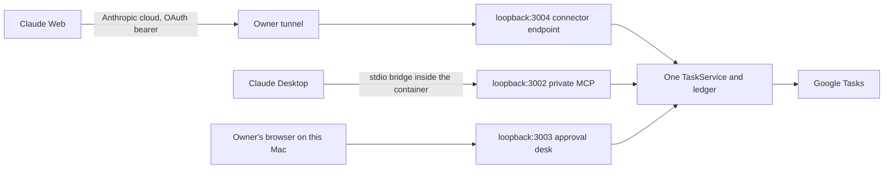

# Claude Web and Claude Desktop connection

Parent: [docs component](SPEC.md). Decision: [D039](DECISIONS.md#d039--local-approval-desk-and-claude-connections-2026-11-04-owner-approved). Implementation: [MCP](../src/mcp/SPEC.md), [containers](../containers/SPEC.md). Evidence: [TEST_PLAN](TEST_PLAN.md#claude-and-local-approval-verification--2026-11-04).

One owner and one Google account, running on the owner's Mac. Most users should run `./setup.sh`, which does the Desktop steps below. This is not a multi-user or hosted service. The Mac, Docker and the service must be running; Claude Web also needs the tunnel.



## How a write works

Authorize once ([D041](DECISIONS.md)): connect the account, and optionally choose "Always allow" when Claude first asks about a tool. After that Claude writes directly. Updates use `If-Match`, so a task changed since it was read is refused rather than overwritten. There is no delete tool.

**Optional strict mode:** set `TASKS_WRITE_APPROVAL=local` in `.host/runtime.env` and recreate the service. With writes on, any value other than `direct` or `local` refuses to start. Each write then returns an `approvalUrl` on `http://127.0.0.1:3003`; open it on this Mac, check the content, approve or reject, and have Claude retry with the same key within 5 minutes. Only trust links on `127.0.0.1:3003`.

Google Calendar is not handled by this project: use the Google Calendar connector in the same conversation. Deletion is not a tool; only the fixed test harness deletes its own disposable data.

## Enable or change writes

Run `./setup.sh`, answer yes to writes, and connect again so the Google grant includes write access. It sets `TASKS_REAL_WRITES` and `TASKS_WRITE_APPROVAL` in `.host/runtime.env`.

Choose the account carefully: the Tasks API does not report account identity, so this choice is the only check. Reconnecting creates a new connection identity, so existing pending proposals no longer apply.

## Claude Desktop (Mac)

Add this server to `~/Library/Application Support/Claude/claude_desktop_config.json`, using the real repository path, then fully quit and reopen Claude Desktop. No credential goes into this file.

```json
{"mcpServers":{"google-tasks":{"command":"/bin/sh","args":["/path/to/google-tasks-mcp/containers/claude-desktop-stdio.sh"]}}}
```

Edit the file only while Claude Desktop is fully quit. On 2026-11-04 a running app removed a newly added `mcpServers` entry within 20 seconds. An edit made while quit survived the restart and the tools loaded. `./setup.sh` does this for you.

The bridge starts the service if it is stopped, and joins it rather than starting a second one. Claude Desktop also shows connectors added for Claude Web, so if both are enabled turn one off in the chat's connector menu to avoid duplicate tools.

## Claude Web

Claude connects from Anthropic's cloud, so the service needs a public HTTPS URL. [Private MCP tunnels are Enterprise-only](https://claude.com/docs/connectors/mcp-tunnels/oauth). Use a tunnel the owner controls, forwarding to `http://127.0.0.1:3004`. A stable hostname is better: changing it means re-adding the connector.

1. Start a tunnel and note its HTTPS origin, for example with [Cloudflare Tunnel](https://developers.cloudflare.com/cloudflare-one/connections/connect-networks/) or ngrok. The tunnel must forward the original `Host` header.
2. Save the bare origin and restart the service. Without this file the connector endpoint does not start.

   ```bash
   printf '%s' 'https://YOUR-TUNNEL-HOSTNAME' > .data/public-url
   ```

   ```bash
   docker compose -f containers/google-compose.yaml up -d --force-recreate --wait --no-build --pull never
   ```

3. In Claude: **Customize > Connectors > Add custom connector**, URL `https://YOUR-TUNNEL-HOSTNAME/mcp`, sign-in option **Sign in now** or the default, with automatic registration.
4. Your browser is sent to a page on `127.0.0.1:3003`. Allow only if you just started this connection yourself. The page asks for the owner code: run `cat .data/desk.key` in the project folder. This step only works on this Mac, so connect from here; afterwards Claude can use the connector from elsewhere while the service runs, though each write runs directly unless strict mode is on.

To cut off Claude Web, stop the tunnel. To disable the endpoint and revoke its tokens, delete `.data/public-url` and restart. Removing the connector in Claude alone does not revoke tokens on this Mac. Rotated refresh tokens are not tracked as a family, so reuse of an old one is refused without revoking the newer one. Stored OAuth grants are in the private database as SHA-256 digests only.

## Security limits

- Google Tasks is the only store of task content ([D040](DECISIONS.md#d040--google-tasks-is-the-only-store-of-task-content-2026-11-04-owner-approved)). The Mac keeps an undecided proposal for at most 24 hours, then only digests, IDs and states.
- The tunnel exposes discovery, registration, sign-in and token endpoints to the internet. Tool access needs a token, and a token needs the owner's one-time decision on the loopback desk with the owner code from `.data/desk.key`, which is never forwarded: the tunnel reaches port 3004 only. Anyone holding a valid token can write, so stop the tunnel when not in use.
- Google's `tasks` scope covers every list in the account, so a connected Claude can read and change all of them. A dedicated account limits the damage if something goes wrong.
- A model misled by task notes or web content can update or complete tasks without asking you. Overwritten titles and notes cannot be recovered. Use strict mode if that matters for an account.
- Any process running as the owner's OS user can read the owner code and script a decision, so strict mode does not constrain a coding agent with shell or browser access on this Mac.
- An owner tricked into allowing someone else's connection attempt would grant that party reads and writes. Allow only attempts you just started.
- A restored older database loses newer ledger entries, so an old key could be sent again; no control detects this yet (Q04). Restoring the database is not an approved procedure.

## Sources

Checked 2026-11-04: [custom connectors](https://claude.com/docs/connectors/custom/remote-mcp), [authentication requirements](https://claude.com/docs/connectors/building/authentication.md), [testing a local server](https://claude.com/docs/connectors/building/testing.md), [local servers in Claude Desktop](https://modelcontextprotocol.io/docs/2026-07-28/develop/connect-local-servers). Plan availability and UI labels can change; verify during setup. Whether Claude Web or Desktop render MCP form elicitation was not established from official documentation, and this design does not depend on it.
