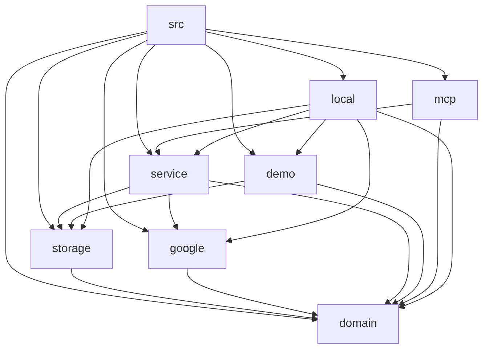

# Context Router

Google Tasks MCP 協助 ChatGPT 安全讀取、提出新增／修改／完成操作。產品意圖及驗收以 [PRD](PRD.md) 為準；目前實作證據、未完成能力與正式放行分別見 [測試紀錄](TEST_PLAN.md)、[架構](ARCHITECTURE.md)、[放行計畫](RELEASE_PLAN.md)。本頁提供路徑，不重新定義產品規則。

## 按任務載入

| 工作 | 最小閱讀路徑 |
|---|---|
| 修改工具輸入 | `npm run context -- domain` → Zod `schemas` → PRD 對應 R ID → 相關測試 |
| 搜尋／核准／防重 | `npm run context -- service` → PRD → 必要的 service／storage／MCP 來源 |
| 資料結構 | `npm run context -- storage` → Store 初始化 DDL → 持久化決策與恢復測試 |
| OAuth／Google REST | `npm run context -- google` → [官方限制核對](API_CONSTRAINTS.md) → 未解決策與相關測試 |
| 改架構或跨元件介面 | [架構限制](ARCHITECTURE.md) → [決策／Open Questions](DECISIONS.md) → 下方允許相依政策 |
| 開發、審查與同步 | [AGENTS](../AGENTS.md) → [工程流程](ENGINEERING_WORKFLOW.md) → 受影響元件 SPEC |
| 個人試用／連線 | [使用者指南](USER_TESTING.md) → [ChatGPT 接線紀錄](CHATGPT_CONNECTION.md)／[Claude 連線](CLAUDE_CONNECTION.md) |
| 理解這次重構與示範 | [稽核及交付紀錄](CONTEXT_AUDIT.md) |

`npm run context -- <元件 id>` 只顯示選定 SPEC 的目前契約與權威路徑；省略歷史、指紋及權威文件內容。只有需要某項知識時才讀取其內容。`npm run context -- --sources` 只列出權威來源。所有 metadata 路徑會先驗證邊界，不以登錄檔授予讀取秘密的權限。

現有模組 `SPEC.md` 已具備用途、邊界、上下層、實作定位與決策，不再另建重複 README。父子／相依連結是導航；精確輸入、資料表、實際行為由對應來源定義。歷史紀錄保留當時觀察，不作目前契約。遇到實作與需求不同，記為差異，不自動以實作覆寫需求。

## 權威來源與元件導航（自動產生）

下方的來源歸屬、模組選擇與允許相依皆以 [components.json](../components.json) 為唯一 metadata 來源。CI 比對產生結果；檢查只能確認結構與引用，不能證明自然語言語意正確。

<!-- context-map:start -->
此區塊由 `components.json` 產生；請執行 `npm run context:generate`，不要手改。

| 知識 ID | 權威來源 | 範圍 |
|---|---|---|
| requirements | [docs/PRD.md](../docs/PRD.md) | 已確認業務目的、需求與 R01–R10 驗收；建議保持建議狀態 |
| api | [src/domain/index.ts](../src/domain/index.ts) | Code-first：schemas 與其推導型別；不另手寫 OpenAPI |
| database | [src/storage/index.ts](../src/storage/index.ts) | Store 初始化 DDL；目前沒有獨立 migration 系統 |
| architecture | [docs/ARCHITECTURE.md](../docs/ARCHITECTURE.md) | 架構限制、已實作與目標邊界；允許依賴以 components.json 為準 |
| decisions | [docs/DECISIONS.md](../docs/DECISIONS.md) | 跨元件理由、替代方案、狀態與 Open Questions |
| instructions | [AGENTS.md](../AGENTS.md) | Agent 工作規則，不承載完整業務知識 |
| validation | [docs/TEST_PLAN.md](../docs/TEST_PLAN.md) | 測試策略與已觀察證據；不等同需求權威 |
| release | [docs/RELEASE_PLAN.md](../docs/RELEASE_PLAN.md) | 放行案例與阻擋；需求引用 PRD，不重定義需求 |
| versions | [package.json](../package.json) | 套件版本與 npm 契約；Node patch 另以 .nvmrc 固定 |
| node | [.nvmrc](../.nvmrc) | 標準 Node patch；同步容器仍由完整驗證確認 |

| 模組 | 定位規格 | 按需載入的知識 ID |
|---|---|---|
| project | [SPEC.md](../SPEC.md) | instructions, requirements, architecture, decisions, versions, node |
| src | [src/SPEC.md](../src/SPEC.md) | architecture, api, decisions |
| domain | [src/domain/SPEC.md](../src/domain/SPEC.md) | api, requirements |
| storage | [src/storage/SPEC.md](../src/storage/SPEC.md) | database, requirements, decisions |
| google | [src/google/SPEC.md](../src/google/SPEC.md) | api, requirements, decisions |
| service | [src/service/SPEC.md](../src/service/SPEC.md) | requirements, api, database, decisions |
| demo | [src/demo/SPEC.md](../src/demo/SPEC.md) | requirements, database |
| mcp | [src/mcp/SPEC.md](../src/mcp/SPEC.md) | api, requirements, decisions |
| local | [src/local/SPEC.md](../src/local/SPEC.md) | requirements, decisions |
| tests | [tests/SPEC.md](../tests/SPEC.md) | requirements, api, validation |
| scripts | [scripts/SPEC.md](../scripts/SPEC.md) | instructions, architecture, validation |
| skills | [skills/SPEC.md](../skills/SPEC.md) | requirements, decisions |
| docs | [docs/SPEC.md](../docs/SPEC.md) | requirements, architecture, decisions, validation, release |
| workflows | [.github/workflows/SPEC.md](../.github/workflows/SPEC.md) | validation, versions, node |
| containers | [containers/SPEC.md](../containers/SPEC.md) | architecture, release, versions, node |

允許的跨元件來源相依（政策，非自動推測的實際相依圖）：

<!-- context-map:end -->

## 圖與維護

跨元件允許關係由上方 metadata 產生；[合成核准 sequence](ARCHITECTURE.md) 是帶有適用範圍的說明圖，變更由獨立 reviewer 對照實作。領域目的／驗收修改 PRD；機器契約修改 schema／DDL；理由追加 ADR；元件局部影響追加 SPEC。生成區域用 `npm run context:generate` 重建，再更新受影響 SPEC 並跑 `npm run check`。

維護角色以提交變更者負責來源與 SPEC 同步、獨立 reviewer 核對意圖與證據；特定業務決策的最終 owner 尚未指派時，保持 DECISIONS 待確認狀態，不由代理自封。各知識的維護方式：

| 類型 | 更新／衍生流程 | 驗證 |
|---|---|---|
| 意圖、架構、理由與放行 | 修改其已登錄來源，其他頁引用；需求以 R ID 追蹤 | 獨立語意審查＋相關情境測試 |
| API、DDL、版本及目前行為 | 改既有原始碼／設定，不生成第二套手寫規格 | 型別、產品與合成測試；資料演進另評估相容性 |
| metadata 與模組入口 | 改登錄或 SPEC → context:generate → docs:stamp | docs:check／context:check／docs:test |
| Agent 工作原則 | 整合適用 AGENTS，具體知識只連結 | diff 審查及文件連結檢查 |

所屬：[docs 規格](SPEC.md)；根層定位：[project SPEC](../SPEC.md)。
